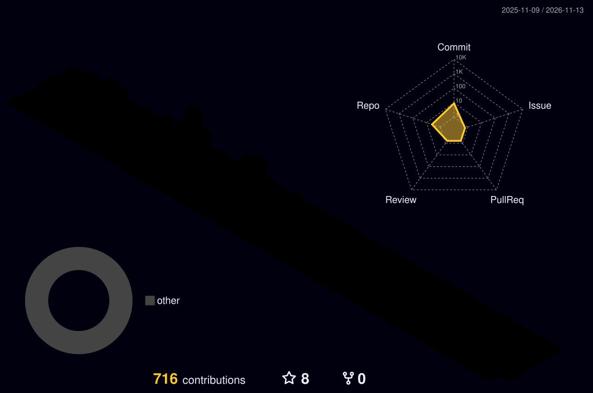

 

---

## 👋 À propos

Développeur **Full-Stack** autodidacte et créatif, je couvre toute la chaîne d'un produit : **conception UX/UI**, **front-end**, **back-end et API**, **déploiement cloud (DevOps)** et **intelligence artificielle**.
J'ai travaillé sur des produits très différents (fintech, e-learning, e-commerce, immobilier, voyage, FoodTech, santé), ce qui m'a appris à m'adapter vite à un nouveau domaine et à de nouvelles technologies.

| | |
|---|---|
| 🎨 **UX / UI** | Wireframes, maquettes et prototypes interactifs (Figma, Adobe XD, Miro), Design Systems et Design Tokens |
| 🖥️ **Front-end** | React, Next.js, TanStack Start, Astro, SvelteKit, Tailwind CSS, architecture Feature-First et Atomic Design |
| ⚙️ **Back-end & API** | NestJS, Node.js / Express, PHP (Laravel, Symfony), Go, Python, conception d'API REST, intégration de PSP et du GDS Amadeus |
| 🧱 **Architecture** | Hexagonale, Clean Architecture, DDD, CQRS, Event Sourcing, microservices, monorepo, SOLID |
| ☁️ **DevOps & Cloud** | AWS, Docker, Kubernetes, ArgoCD, Terraform, CI/CD (GitHub Actions, GitLab CI), Nginx, Hetzner, Cloudflare |
| 📈 **Observabilité** | Signoz, OpenTelemetry, Grafana, Prometheus, Loki, Tempo, Sentry, CloudWatch, UptimeRobot |
| 🤖 **IA / ML** | TensorFlow, Keras, OpenCV, NumPy, Pandas, classification d'images médicales |
| 📱 **Mobile** | Flutter |

---

## 🛠️ Stack

**Langages**

**Front-end & mobile**

**Back-end & bases de données**

**Cloud, DevOps & observabilité**

**IA / ML**

<b>Voir la liste complète des outils</b>

- **Front-end** : JavaScript (ES6+), React Query, Axios, Fetch API, TanStack Start, Design Tokens
- **Architecture** : Hexagonale, DDD, CQRS, Event Sourcing, microservices, monorepo, monolithe modulaire
- **DevOps** : ArgoCD, Kubernetes, Terraform, Docker, Nginx, Portainer, Lens, SonarQube, Unleash (feature flags)
- **Observabilité** : Signoz, OpenTelemetry, Grafana, Prometheus, Loki, Tempo, Sentry, CloudWatch, UptimeRobot
- **IA / ML** : TensorFlow, Keras, NumPy, Pandas, Matplotlib, OpenCV, classification, régression
- **Design** : Figma, Adobe XD, wireframes, prototypage interactif, Miro, Scene Builder
- **Gestion de projet** : Git, GitHub, GitLab, Jira, Trello, Asana, Slack, MS Project

---

## 🧊 Mon activité en 3D

  <picture>
    <source media="(prefers-color-scheme: dark)" srcset="./profile-3d-contrib/profile-night-rainbow.svg">
    <source media="(prefers-color-scheme: light)" srcset="./profile-3d-contrib/profile-green-animate.svg">
    
  </picture>

Généré automatiquement chaque nuit par une GitHub Action ([`profile-3d.yml`](./.github/workflows/profile-3d.yml)).

---

## 🧭 Ce que j'ai construit

| Domaine | Réalisations |
|---|---|
| 🏦 **Fintech** | Backend et API d'une Super-App financière (transactions, paiements, services tiers) ; API d'un agrégateur de paiement multi-pays ; intégration de multiples PSP |
| 🎓 **E-learning & e-commerce** | Plateforme e-learning et portail de prospection (de la landing page au back-office) ; plateforme e-commerce. Front Next.js, back NestJS (Fastify), déploiement AWS EC2 |
| 🏠 **Immobilier** | Plateformes web pour le marché canadien (location court séjour type Airbnb) ; backend de gestion cadastrale de terrains et lots |
| ✈️ **Voyage** | Application full-stack avec intégration du GDS Amadeus et de PSP |
| 🌾 **FoodTech** | Application web interne de back-office et outil de cartographie des clients et des commerciaux terrain |
| 🎵 **Musique & événementiel** | Application de notation, gestion et écoute musicale (Next.js, PHP / Symfony) |
| 🩺 **Santé & IA** | Dispositif connecté de dépistage précoce du cancer du sein : backend, modèle d'analyse d'images médicales et CI/CD. **2e Prix Orange Summer Challenge 2024** |
| 🎨 **UX / UI** | Interfaces, wireframes et prototypes interactifs pour applications web et mobiles |

### 🚀 Projet en vedette : LedgerX
`Go` · `PostgreSQL` · `Event Sourcing`

Moteur de grand livre financier (Ledger) basé sur l'**Event Sourcing**, garantissant l'**immutabilité des écritures comptables** et l'**isolation multi-tenant**.
👉 [Voir mes dépôts](https://github.com/marc14444?tab=repositories)

---

## 🎓 Formation & certifications

- **Master en Big Data Analytics** et **Licence en Informatique et Sciences du Numérique** : Université Virtuelle de Côte d'Ivoire (UVCI)
- Certifié **Développeur Full-Stack** (NaN Digital Academy) · **Cloud AWS / DevOps** (Simplon CI) · **ML / IA** (Udemy)
- **Robotique & prototypage ROS**, **découpe laser et création 2D** (Orange Digital Center) · **Sécurité informatique** (Cisco Academy)

**Langues** : Français (langue maternelle) · Anglais (intermédiaire) · Allemand (notions)

---

## 📊 Statistiques GitHub

  
  
   
  

---

## 📫 Me contacter

